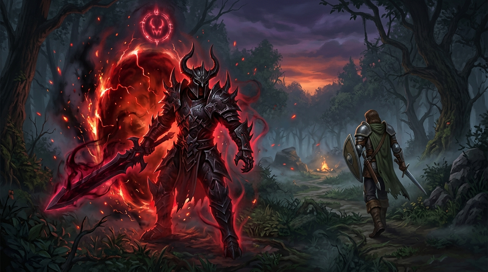

<p align="center">
  
</p>

# mod-twow-invasions: World PvP Invasions & PlayerBot Phantoms

> **Dark Souls-style asynchronous World PvP Invasions and autonomous PlayerBot Phantoms for Turtle WoW (vMaNGOS 1.12.1 / 1.18.1).**  
> *Channel the fiery rite, teleport 10 yards behind unsuspecting flagged players or roaming bots, and battle inside a high-stakes 100-yard duel arena.*

---

[](https://turtle-wow.org/)
[-blue.svg)]()
[]()
[]()
[](LICENSE)

---

## 📖 Origin & Attribution

> [!NOTE]
> This module was originally designed and created for **ComfyCraft** (`InvasionMgr`). It has been decoupled from monolithic core code, ported, and significantly extended to work natively as a 100% standalone, non-intrusive module for **`tortoise-wow`** (Turtle WoW custom vMaNGOS) and **`TortoiseBots`**.

### 🌟 Turtle WoW (`tortoise-wow`) & PlayerBot Extensions:
- **Autolearned Spellbook Mode**: Directly learned in the Spellbook (General tab) upon reaching level 10 (`Invasion.MinLevel`). No inventory clutter or bag space required.
- **Autonomous PlayerBot Phantoms**: Wandering PlayerBots can invade real players like Dark Souls NPC Phantoms (*Kirk*, *Mildred*), players can invade bots as fallback, and bots can invade bots.
- **Zero Core Patches (The Unediting Doctrine)**: Mutual hostility across factions and in town sanctuaries is achieved through temporary `SetFFAPvP(true)` inside the 100-yard arena, completely eliminating the need for ComfyCraft's hardcoded core `GetReactionTo` modifications.
- **Dual Access Modes**: Seamless support for Spellbook mode (Mode 1), physical inventory Talisman (Mode 2), or Hybrid (Mode 3).
- **PvP Victor Rewards**: Direct Honor and Gold payouts awarded to match victors.

---

## ⚔️ Overview & Gameplay Flow

1. **The Stalking Warning**: The defender receives an ominous screen prompt (*"Something has come to forgive you"*) 5 seconds before the invader lands, allowing a moment to prepare.
2. **The Ambush**: The invader teleports **10 yards directly behind** the defender with a dark visual effect (`ARRIVE_KIT`), while stealth is preserved for Rogues and Druids.
3. **The 100-Yard Arena Leash**: An invisible duel boundary forms around the arrival point. Fleeing further than 100 yards triggers a 10-second countdown to return or forfeit.
4. **Asymmetric Death**: A defeated defender revives directly over their corpse without running from a distant graveyard; a fallen invader is carried home to their starting location dead and automatically resurrected.

---

## ✨ Features

- **🔥 Autolearned Spell Mode (Default)**: Automatically unlocked directly in the Spellbook upon reaching level 10 (`Invasion.MinLevel`).
- **📜 Optional Physical Talisman**: Configurable option to enable the physical *Invader's Sigil* (Item `100035`) and gossip vendor NPC *Mordrin the Marked* (`100031`).
- **🤖 Autonomous PlayerBot Phantom Invasions**:
  - **Bot $\rightarrow$ Player**: Wandering PlayerBots can channel the rite and invade real players.
  - **Player $\rightarrow$ Bot**: When no real human players are flagged or online, matchmaking falls back to roaming PlayerBots.
  - **Bot $\rightarrow$ Bot**: Autonomous simulated world PvP encounters across factions.
  - **Balanced Pacing**: Configurable check intervals (`Invasion.BotInvasionInterval`), roll chances (`Invasion.BotInvasionChance`), personal bot cooldowns, and realm-wide active invasion caps.
- **🛡️ Strictly Non-Intrusive**: Zero core modifications to `tortoise-wow` or `TortoiseBots`.
- **📡 Minimap Radar Tracking**: Real-time positional radar updates transmitted via the `CINV` addon channel every 250ms.
- **🏆 Standard PvP Rewards**: Victorious invaders and defenders receive standard PvP Honor points and Gold directly into their purse.
- **🕊️ Anti-Grief Respite Timer**: Invaded defenders receive an immunity cooldown (default: 10 minutes) preventing back-to-back harassment.
- **⏱️ Action Bar Cooldown Wheel**: Configurable invader cooldown (`Invasion.InvaderCooldownSeconds`) preventing spamming and rendering native rotating spell cooldown clocks on the action bar.
- **⚔️ Same-Faction & Cross-Faction Isolation**: Configurable toggle (`Invasion.AllowSameFaction = 1`) enabling cross-faction and same-faction Dark Souls-style invasions. FFA flags are isolated strictly to same-faction matches so friendly bystanders in cross-faction battles are never affected.
- **🏛️ Safe Zone Cast Isolation**: Configurable toggle (`Invasion.AllowInvadeFromSafeZones = 0`) allowing players/bots to cast the invasion rite from safe zones or capital cities, while preserving complete safe zone immunity for defenders against being invaded.
- **⚔️ Active Bot PvP Aggression**: Bots immediately face, target, and attack each other on arrival (`Invasion.BotEngagePvP = 1`), applying native TortoiseBots PvP combat strategies (`Invasion.BotPvPStrategies = "+pvp,+world pvp"`).
- **🔄 Clean Bot AI Reset**: Upon match conclusion or forfeit, bot combat states and decision trees are completely reset (`Invasion.BotResetAI = 1`), cleanly restoring their normal open-world behavior.

---

## ⚙️ Configuration Reference (`mod-twow-invasions.conf`)

```ini
[ModuleConf]
# Master switch
Invasion.Enable = 1
Invasion.Debug = 0

# Access Modes: 1 = Spell Only (Default), 2 = Item Only, 3 = Hybrid
Invasion.AccessMode = 1
Invasion.MinLevel = 10
Invasion.SpellId = 44090
Invasion.EnableTalisman = 0

# Matchmaking & Rules
Invasion.LevelRange = 3
Invasion.AllowSameFaction = 1
Invasion.AllowInCities = 0
Invasion.AllowInSanctuaries = 0
Invasion.AllowInvadeFromSafeZones = 0
Invasion.InvaderCooldownSeconds = 60
Invasion.WarnSeconds = 5
Invasion.DurationSeconds = 300
Invasion.RespiteSeconds = 600
Invasion.ArriveDistance = 10
Invasion.ReturnSeconds = 5
Invasion.DeathLingerSeconds = 10
Invasion.ReviveSeconds = 3

# Rewards
Invasion.RewardHonor = 75
Invasion.RewardMoney = 5000

# PlayerBot Phantoms Matrix & AI Pacing
Invasion.AllowPlayerToBot = 1
Invasion.AllowBotToPlayer = 1
Invasion.AllowBotToBot = 1
Invasion.BotInvasionInterval = 300
Invasion.BotInvasionChance = 30
Invasion.BotCooldownSeconds = 600
Invasion.BotMaxActiveInvasions = 3
Invasion.BotEngagePvP = 1
Invasion.BotPvPStrategies = "+pvp,+world pvp"
Invasion.BotResetAI = 1
```

---

## 🚀 Installation

These steps assume you have a working [TortoiseWoW](https://github.com/Penqle/tortoise-wow) source checkout, initialized core databases, and the server data files for your realm. Use a core revision compatible with this module. Run all build and SQL commands from the core source root, the directory containing the core's `CMakeLists.txt`.

TortoiseBots is optional for player-only invasions. For bot phantoms, install and configure a core-compatible [TortoiseBots](https://github.com/tortoise-wow-stack/TortoiseBots) checkout under `modules/TortoiseBots` and add `-DMODULE_TORTOISEBOTS=static` to the CMake configure command.

### 1. Add the module and build on Linux

Use Git, CMake, a C++17 compiler, and the core's build dependencies. On Debian or Ubuntu, a typical starting point is:

```bash
sudo apt update
sudo apt install git cmake build-essential libace-dev default-libmysqlclient-dev libssl-dev zlib1g-dev
```

Use your distribution's `mysql` or `mariadb` command-line client if importing SQL manually. Keep any additional dependency and CMake settings required by your core and other enabled modules.

```bash
cd /path/to/tortoise-wow
git clone https://github.com/Ildourol/mod-twow-invasions.git modules/mod-twow-invasions
cmake -S . -B build -DCMAKE_BUILD_TYPE=Release -DCMAKE_INSTALL_PREFIX="$PWD/server-stage" -DMODULE_MOD_TWOW_INVASIONS=static
cmake --build build --parallel
cmake --install build
```

### 2. Add the module and build on Windows

Install Git for Windows, CMake 3.21 or later, and Visual Studio 2022 or its Build Tools with **Desktop development with C++** and a Windows SDK. Open PowerShell with Git and CMake on `PATH`. Use an x64 build and the dependency setup of your working core.

```powershell
Set-Location 'C:\src\tortoise-wow'
git clone https://github.com/Ildourol/mod-twow-invasions.git modules/mod-twow-invasions
cmake -S . -B build-vs -G "Visual Studio 17 2022" -A x64 "-DCMAKE_INSTALL_PREFIX=$PWD/server-stage" -DMODULE_MOD_TWOW_INVASIONS=static
cmake --build build-vs --config Release --parallel
cmake --install build-vs --config Release
```

Check each command for errors before continuing. Both builds include `mangosd`. If the configure output reports an unused module switch, verify the source placement before building. The two build sections are platform alternatives. If you already have a module checkout, use it in place of the clone. A full directory copy, a Linux symlink, or a Windows directory junction works as long as `modules/mod-twow-invasions/src/` is directly below the module directory. The module directory name determines the CMake switch and loader symbol. If reusing a build directory, keep its generator and architecture and preserve the switches for your other modules. Reconfigure after adding the module and verify CMake lists it as static.

The staged world server is normally `server-stage/bin/mangosd` on Linux and `server-stage/mangosd.exe` on Windows. Stop the running world server before deploying the rebuilt executable and any required runtime libraries or module assets. Preserve the live configuration and data files. The paths below assume the standard staged layout. For an existing deployment, use the directory containing the active `mangosd.conf`, including a custom path passed via `-c`.

### 3. Set up the database

Back up the affected databases. The examples use `tw_char` and `tw_world` as database names. Substitute the names from the active `CharacterDatabase.Info` and `WorldDatabase.Info` settings as applicable, plus your database user and any connection options.

Choose 1 import method. For the core auto-updater, verify that `Database.AutoUpdate.Enabled` and `Database.AutoUpdate.SortByName` are enabled, that `Database.AutoUpdate.AllowedModules` includes `mod-twow-invasions` (or uses `all`), and that the runtime host can access the module checkout at the source path embedded by the build. The updater uses the configured `CharUpdateName` and `WorldUpdateName` under `data/sql/` (normally `character` and `world`). Check the first startup log for applied updates. If importing manually, exclude this module from the updater allowlist to avoid replaying the same files. Preserve other modules that use automatic updates.

**Manual import on Linux (Bash)**

```bash
mysql -u root -p tw_char < "modules/mod-twow-invasions/data/sql/character/001_invasion_match_history.sql"
mysql -u root -p tw_world < "modules/mod-twow-invasions/data/sql/world/001_invasion_spell_and_item.sql"
```

**Manual import on Windows (PowerShell)**

Run `Get-Command mysql.exe` first. If it is unavailable, install the MySQL or MariaDB command-line client and add its `bin` directory to the current PowerShell session. Replace the example path below with your installation path. Use `mariadb.exe` in the import commands if that is the client you installed. Run imports in the order shown and stop if any command reports an error. `cmd.exe` handles input redirection so the SQL file reaches the client directly.

```powershell
# Only needed when mysql.exe is installed but missing from PATH
# $env:Path = 'C:\Program Files\MySQL\MySQL Server 8.0\bin;' + $env:Path
cmd.exe /d /c 'mysql.exe -u root -p tw_char < modules\mod-twow-invasions\data\sql\character\001_invasion_match_history.sql'
if ($LASTEXITCODE -ne 0) { throw "Module SQL import failed" }
cmd.exe /d /c 'mysql.exe -u root -p tw_world < modules\mod-twow-invasions\data\sql\world\001_invasion_spell_and_item.sql'
if ($LASTEXITCODE -ne 0) { throw "Module SQL import failed" }
```

### 4. Deploy and enable the configuration

Create `mod-twow-invasions.conf` inside the `modules/` subdirectory beside the active `mangosd.conf`. For a first install using the example staging directory, the following commands copy the shipped template. If an active module config already exists, retain it and merge new settings from the template.

**Linux**

```bash
mkdir -p server-stage/etc/modules
cp -n "modules/mod-twow-invasions/conf/mod-twow-invasions.conf.dist" "server-stage/etc/modules/mod-twow-invasions.conf"
```

**Windows (PowerShell)**

```powershell
New-Item -ItemType Directory -Force 'server-stage/modules' | Out-Null
if (-not (Test-Path 'server-stage/modules/mod-twow-invasions.conf')) {
    Copy-Item 'modules/mod-twow-invasions/conf/mod-twow-invasions.conf.dist' 'server-stage/modules/mod-twow-invasions.conf'
}
```

Keep the template's section header and confirm `Invasion.Enable = 1` in the active file. Start the rebuilt server with your normal launcher and active `mangosd.conf`. Check the startup log for module configuration, database, and dependency errors.

### Verify the installation

On a test realm, confirm the configured access mode is available and test an invasion between eligible characters. For bot phantoms, check that CMake discovered TortoiseBots and that it is running.

## 📄 License & Credits

- Licensed under **GPL v2**.
- **ComfyCraft**: Original invasion system concept, items, and mechanics.
- **tortoise-wow & TortoiseBots**: Native Turtle vMaNGOS architecture, standalone decoupling, non-intrusive FFA hostility, and autonomous PlayerBot phantom integrations.
