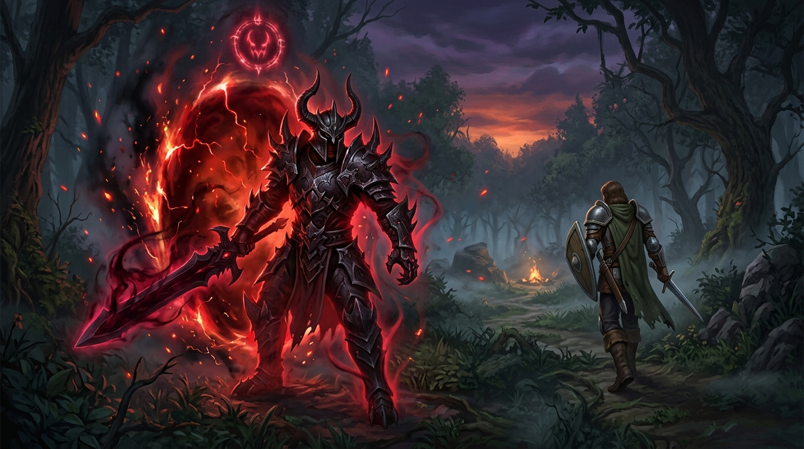

<p align="center">
  
</p>

# mod-twow-invasions: World PvP Invasions & PlayerBot Phantoms

> **Dark Souls-style asynchronous World PvP Invasions and autonomous PlayerBot Phantoms for Turtle WoW (vMaNGOS 1.12.1 / 1.18.1).**  
> *Channel the fiery rite, teleport 10 yards behind unsuspecting flagged players or roaming bots, and battle inside a high-stakes 100-yard duel arena.*

---

[](https://turtle-wow.org/)
[-blue.svg)]()
[]()
[]()
[](LICENSE)

---

## 📖 Origin & Attribution

> [!NOTE]
> This module was originally designed and created for **ComfyCraft** (`InvasionMgr`). It has been decoupled from monolithic core code, ported, and significantly extended to work natively as a 100% standalone, non-intrusive module for **`tortoise-wow`** (Turtle WoW custom vMaNGOS) and **`TortoiseBots`**.

### 🌟 Turtle WoW (`tortoise-wow`) & PlayerBot Extensions:
- **Autolearned Spellbook Mode**: Directly learned in the Spellbook (General tab) upon reaching level 10 (`Invasion.MinLevel`). No inventory clutter or bag space required.
- **Autonomous PlayerBot Phantoms**: Wandering PlayerBots can invade real players like Dark Souls NPC Phantoms (*Kirk*, *Mildred*), players can invade bots as fallback, and bots can invade bots.
- **Zero Core Patches (The Unediting Doctrine)**: Mutual hostility across factions and in town sanctuaries is achieved through temporary `SetFFAPvP(true)` inside the 100-yard arena, completely eliminating the need for ComfyCraft's hardcoded core `GetReactionTo` modifications.
- **Dual Access Modes**: Seamless support for Spellbook mode (Mode 1), physical inventory Talisman (Mode 2), or Hybrid (Mode 3).
- **PvP Victor Rewards**: Direct Honor and Gold payouts awarded to match victors.

---

## ⚔️ Overview & Gameplay Flow

1. **The Stalking Warning**: The defender receives an ominous screen prompt (*"Something has come to forgive you"*) 5 seconds before the invader lands, allowing a moment to prepare.
2. **The Ambush**: The invader teleports **10 yards directly behind** the defender with a dark visual effect (`ARRIVE_KIT`), while stealth is preserved for Rogues and Druids.
3. **The 100-Yard Arena Leash**: An invisible duel boundary forms around the arrival point. Fleeing further than 100 yards triggers a 10-second countdown to return or forfeit.
4. **Asymmetric Death**: A defeated defender revives directly over their corpse without running from a distant graveyard; a fallen invader is carried home to their starting location dead and automatically resurrected.

---

## ✨ Features

- **🔥 Autolearned Spell Mode (Default)**: Automatically unlocked directly in the Spellbook upon reaching level 10 (`Invasion.MinLevel`).
- **📜 Optional Physical Talisman**: Configurable option to enable the physical *Invader's Sigil* (Item `100035`) and gossip vendor NPC *Mordrin the Marked* (`100031`).
- **🤖 Autonomous PlayerBot Phantom Invasions**:
  - **Bot $\rightarrow$ Player**: Wandering PlayerBots can channel the rite and invade real players.
  - **Player $\rightarrow$ Bot**: When no real human players are flagged or online, matchmaking falls back to roaming PlayerBots.
  - **Bot $\rightarrow$ Bot**: Autonomous simulated world PvP encounters across factions.
  - **Balanced Pacing**: Configurable check intervals (`Invasion.BotInvasionInterval`), roll chances (`Invasion.BotInvasionChance`), personal bot cooldowns, and realm-wide active invasion caps.
- **🛡️ Strictly Non-Intrusive**: Zero core modifications to `tortoise-wow` or `TortoiseBots`.
- **📡 Minimap Radar Tracking**: Real-time positional radar updates transmitted via the `CINV` addon channel every 250ms.
- **🏆 Standard PvP Rewards**: Victorious invaders and defenders receive standard PvP Honor points and Gold directly into their purse.
- **🕊️ Anti-Grief Respite Timer**: Invaded defenders receive an immunity cooldown (default: 10 minutes) preventing back-to-back harassment.
- **⏱️ Action Bar Cooldown Wheel**: Configurable invader cooldown (`Invasion.InvaderCooldownSeconds`) preventing spamming and rendering native rotating spell cooldown clocks on the action bar.
- **⚔️ Same-Faction & Cross-Faction Isolation**: Configurable toggle (`Invasion.AllowSameFaction = 1`) enabling cross-faction and same-faction Dark Souls-style invasions. FFA flags are isolated strictly to same-faction matches so friendly bystanders in cross-faction battles are never affected.
- **🏛️ Safe Zone Cast Isolation**: Configurable toggle (`Invasion.AllowInvadeFromSafeZones = 0`) allowing players/bots to cast the invasion rite from safe zones or capital cities, while preserving complete safe zone immunity for defenders against being invaded.
- **⚔️ Active Bot PvP Aggression**: Bots immediately face, target, and attack each other on arrival (`Invasion.BotEngagePvP = 1`), applying native TortoiseBots PvP combat strategies (`Invasion.BotPvPStrategies = "+pvp,+world pvp"`).
- **🔄 Clean Bot AI Reset**: Upon match conclusion or forfeit, bot combat states and decision trees are completely reset (`Invasion.BotResetAI = 1`), cleanly restoring their normal open-world behavior.

---

## ⚙️ Configuration Reference (`mod-twow-invasions.conf`)

```ini
[ModuleConf]
# Master switch
Invasion.Enable = 1
Invasion.Debug = 0

# Access Modes: 1 = Spell Only (Default), 2 = Item Only, 3 = Hybrid
Invasion.AccessMode = 1
Invasion.MinLevel = 10
Invasion.SpellId = 44090
Invasion.EnableTalisman = 0

# Matchmaking & Rules
Invasion.LevelRange = 3
Invasion.AllowSameFaction = 1
Invasion.AllowInCities = 0
Invasion.AllowInSanctuaries = 0
Invasion.AllowInvadeFromSafeZones = 0
Invasion.InvaderCooldownSeconds = 60
Invasion.WarnSeconds = 5
Invasion.DurationSeconds = 300
Invasion.RespiteSeconds = 600
Invasion.ArriveDistance = 10
Invasion.ReturnSeconds = 5
Invasion.DeathLingerSeconds = 10
Invasion.ReviveSeconds = 3

# Rewards
Invasion.RewardHonor = 75
Invasion.RewardMoney = 5000

# PlayerBot Phantoms Matrix & AI Pacing
Invasion.AllowPlayerToBot = 1
Invasion.AllowBotToPlayer = 1
Invasion.AllowBotToBot = 1
Invasion.BotInvasionInterval = 300
Invasion.BotInvasionChance = 30
Invasion.BotCooldownSeconds = 600
Invasion.BotMaxActiveInvasions = 3
Invasion.BotEngagePvP = 1
Invasion.BotPvPStrategies = "+pvp,+world pvp"
Invasion.BotResetAI = 1
```

---

## 🚀 Installation

1. Clone or copy `mod-twow-invasions` into your core's module directory:
   ```bash
   git clone https://github.com/Ildourol/mod-twow-invasions.git src/modules/mod-twow-invasions
   ```
2. Apply database migrations:
   - `data/sql/character/001_invasion_match_history.sql` $\rightarrow$ `characters` database.
   - `data/sql/world/001_invasion_spell_and_item.sql` $\rightarrow$ `world` database.
3. Copy `conf/mod-twow-invasions.conf.dist` to your server config folder as `mod-twow-invasions.conf` and adjust settings as desired.
4. Re-run CMake and compile your server:
   ```bash
   cmake -B build
   cmake --build build --target mangosd
   ```

---

## 📄 License & Credits

- Licensed under **GPL v2**.
- **ComfyCraft**: Original invasion system concept, items, and mechanics.
- **tortoise-wow & TortoiseBots**: Native Turtle vMaNGOS architecture, standalone decoupling, non-intrusive FFA hostility, and autonomous PlayerBot phantom integrations.
