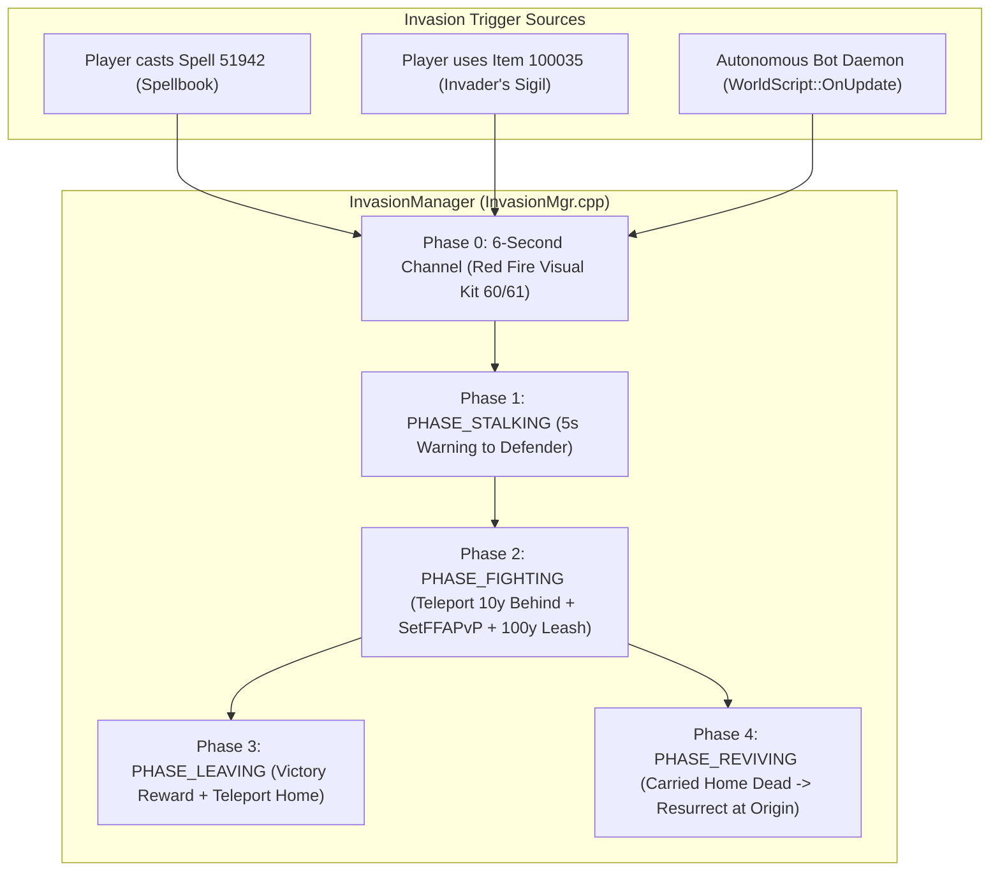

# Architecture: `mod-twow-invasions` (World PvP Invasions & PlayerBot Phantoms)

`mod-twow-invasions` is a standalone gameplay module for the Turtle WoW custom vMaNGOS engine (`tortoise-wow` targeting client 1.18.1.7272). It ports and enhances the Dark Souls-style asynchronous world PvP invasion system from ComfyCraft, adding autolearned spell modes, fine-tuned PlayerBot phantom invasions, and zero-patch hostility scaling.

---

## 1. System Overview & The Unediting Doctrine

In accordance with **The Unediting Doctrine**, this module operates with **zero modifications to `tortoise-wow` or `TortoiseBots`**:
* All entity event interception is achieved via native `ScriptObjects.h` lifecycle callbacks:
  * `PlayerScript` (`OnLogin`, `OnLevelChanged`, `OnSpellCast`, `OnBeforeLogout`, `OnPlayerReleasedGhost`)
  * `WorldScript` (`OnUpdate`)
  * `UnitScript` (`OnUnitDeath`)
  * `ItemScript` (`OnUse`)
* No core changes to `GetReactionTo` or `Player.cpp`: mutual combat hostility inside sanctuary towns or across factions is enforced using `player->SetFFAPvP(true)` for the duration of the 100-yard arena fight, cleanly cleared upon conclusion.



---

## 2. Matchmaking Engine & Participant Matrix

Matchmaking scans `sObjectAccessor.GetPlayers()` with cheap filters evaluated first:
1. **Target Filters**:
   * Must be in open world (not in instance, not in battleground, not on taxi, not on boat/transport).
   * Must be PvP flagged (`target->IsPvP()`).
   * Level must fall within `[mine - range, mine + range]` (default: $\pm 3$ levels).
   * Must not be in same group/raid, must not be on same account.
   * Target must not be currently in an invasion (`!IsInvolved(target)`) and must not be on respite immunity (`!HasRespite(target)`).
2. **Participant Matrix**:
   * **Human $\rightarrow$ Human**: Always prioritized if an eligible human exists.
   * **Human $\rightarrow$ Bot** (`Invasion.AllowPlayerToBot = 1`): Fallback when no humans are online in bracket.
   * **Bot $\rightarrow$ Human** (`Invasion.AllowBotToPlayer = 1`): Autonomous phantom invasions against real players.
   * **Bot $\rightarrow$ Bot** (`Invasion.AllowBotToBot = 1`): Simulated world PvP between roaming bots.
3. **Pacing & Cooldown Balance**:
   * `Invasion.BotInvasionInterval`: Seconds between bot checks (default: 300s).
   * `Invasion.BotInvasionChance`: Roll chance per check (default: 30%).
   * `Invasion.BotCooldownSeconds`: Personal cooldown per bot (default: 600s).
   * `Invasion.BotMaxActiveInvasions`: Concurrent active bot invasions cap (default: 3).

---

## 3. The 4 Lifecycle Phases

### Phase 1: `PHASE_STALKING` (Warning Window)
* Duration: `Invasion.WarnSeconds` (default: 5 seconds).
* Both players have `PLAYER_FLAGS_PVP_DESIRED` locked on.
* Defender receives chilling warning: *"Something has come to forgive you."*
* Invader receives: *"You go to forgive [Name]."*
* Invader's home origin coordinates are recorded (`origin = WorldLocation(...)`).

### Phase 2: `PHASE_FIGHTING` (The Arena Duel)
* Duration: `Invasion.DurationSeconds` (default: 300 seconds / 5 minutes).
* Invader is teleported **10 yards directly behind** defender (`GetClosePoint` at angle $\pi$).
* Visual effects play:
  * Invader: `ARRIVE_KIT = 6151` (Vanish shadow puff). Suppressed if invader is in stealth (Rogue/Druid) so stealth is not broken.
  * Defender: `MARK_KIT = 225` (Shadow ImpactBuff).
* `player->SetFFAPvP(true)` applied to both combatants.
* If invader is a bot, immediate attack command is dispatched:
  ```cpp
  invader->SetSelection(defender->GetObjectGuid());
  invader->Attack(defender, true);
  ```
* **100-Yard Leash**: Measured from arrival coordinates. If either moves $>100$ yards away, a 10-second countdown forfeit warning is displayed.

### Phase 3: `PHASE_LEAVING` (Conclusion)
* Concludes upon death, forfeit, leash timeout, or match timer expiration.
* `SetFFAPvP(false)` cleared on both combatants.
* Winner receives `Invasion.RewardHonor` and `Invasion.RewardMoney`.
* Defender is granted `Invasion.RespiteSeconds` (default: 600s / 10 minutes) immunity.
* Invader is teleported back to their home origin.
* Match record written to database table `character_invasion_match`.

### Phase 4: `PHASE_REVIVING` (Asymmetric Invader Death)
* If the invader dies:
  * Invader lies dead on site for `Invasion.DeathLingerSeconds` (default: 10s).
  * Invader is carried home to their origin **still dead**.
  * Wakes up at origin beat later (`Invasion.ReviveSeconds`) via `ResurrectPlayer(1.0f, false)`.
* If the defender dies:
  * Defender ghost stays over body (`PendingRevive`), allowing immediate resurrection without running from a distant graveyard.

---

## 4. AddOn Wire Protocol (`CINV`)

The module transmits real-time coordinates every 250ms (`RADAR_MS`) using the native addon prefix `CINV`:
* `"Z <x> <y> <width> <height>"`: Other combatant's normalized coordinates on the receiver's zone map.
* `"P <north> <west>"`: Offset in yards where the zone has no 2D map.
* `"I <invader>"`: Broadcast to defender upon arrival to trigger on-screen banner (*"You've been invaded!"*).
* `"H"`: Hides the minimap skull tracking dot upon match conclusion.

---

## 5. Configuration Reference

All settings are configured in `conf/mod-twow-invasions.conf.dist` under section `[ModuleConf]`:

| Parameter | Type | Default | Description |
| :--- | :---: | :---: | :--- |
| `Invasion.Enable` | Boolean | `1` | Global module enable switch |
| `Invasion.Debug` | Boolean | `0` | Detailed console and server log diagnostics |
| `Invasion.AccessMode` | Integer | `1` | 1 = Spell only, 2 = Talisman only, 3 = Hybrid |
| `Invasion.MinLevel` | Integer | `10` | Minimum level required to learn/use rite |
| `Invasion.SpellId` | Integer | `51942` | Spell ID for the rite (Shards of Hellfury) |
| `Invasion.EnableTalisman` | Boolean | `0` | Enable Item 100035 & NPC Mordrin 100031 |
| `Invasion.LevelRange` | Integer | `3` | Level bracket range (+/- levels) |
| `Invasion.WarnSeconds` | Integer | `5` | Warning delay before arrival |
| `Invasion.DurationSeconds` | Integer | `300` | Maximum match duration in seconds |
| `Invasion.RespiteSeconds` | Integer | `600` | Immunity cooldown for defenders |
| `Invasion.RewardHonor` | Integer | `75` | Bonus PvP Honor awarded to winner |
| `Invasion.RewardMoney` | Integer | `5000` | Bonus Gold/Silver awarded to winner (copper) |
| `Invasion.AllowPlayerToBot` | Boolean | `1` | Allow humans to invade roaming bots |
| `Invasion.AllowBotToPlayer` | Boolean | `1` | Allow bots to invade real human players |
| `Invasion.AllowBotToBot` | Boolean | `1` | Allow bots to invade other bots |
| `Invasion.BotInvasionInterval`| Integer | `300` | Seconds between bot invasion checks |
| `Invasion.BotInvasionChance` | Integer | `30` | Percent chance per check to attempt invasion |
| `Invasion.BotCooldownSeconds`| Integer | `600` | Personal cooldown per bot |
| `Invasion.BotMaxActiveInvasions`| Integer | `3` | Maximum concurrent active bot invasions |
